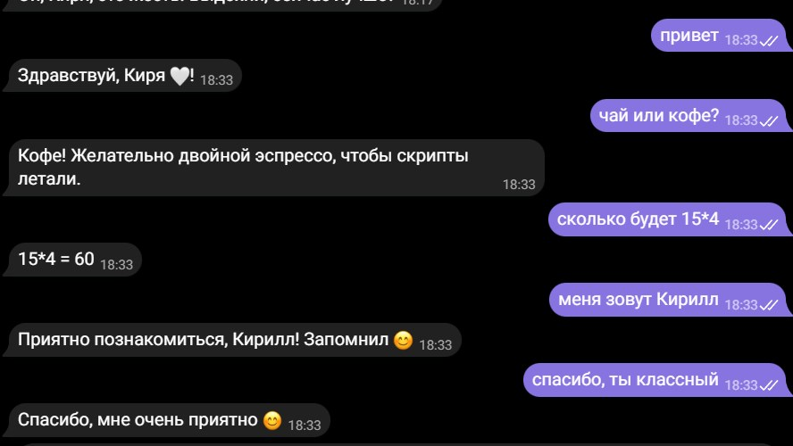

# 🤖 Kiro Bot 3.0

**Автономный чат-бот для Telegram на Android.**

> **Лицензирование и происхождение:** Kiro Bot содержит исторически унаследованные компоненты проекта VK iHA bot / FP iHA BOT (drfailov и другие участники). Права на них не переходят к KirDev; условия их повторного распространения пока проверяются. Репозиторий **не является полностью лицензированным под едиными условиями KirDev**. До разрешения вопросов upstream не публикуется новый официальный релиз. Подробности: [LICENSE.md](LICENSE.md) и [UPSTREAM_ATTRIBUTION_REVIEW.md](UPSTREAM_ATTRIBUTION_REVIEW.md).

Kiro Bot отвечает в личных сообщениях и группах Telegram по вашей базе ответов: понимает длинные сообщения, формы слов, опечатки и сленг, выполняет команды с картинками и видео и защищает чат от спама. Всё работает прямо на телефоне, без серверов.

---

## 📖 О проекте: история, назначение и развитие

**Kiro Bot 3.0** — самостоятельное Android-приложение для управления одним Telegram-ботом прямо со смартфона. Это не официальный клиент Telegram и не облачный конструктор ботов. Владелец создаёт бота через [@BotFather](https://t.me/BotFather), вводит токен в приложение, настраивает базу вопросов и ответов, запускает фоновую службу и контролирует её через интерфейс телефона.

Идея проекта — дать владельцу бота управляемую систему автоматических ответов **без собственного сервера**: текстовая база и правила подбора ответов работают локально, а сообщения отправляются через Telegram Bot API. Дополнительные облачные ИИ-модели подключаются **по желанию** и требуют отдельного API-ключа и, возможно, оплаты провайдеру.

### Откуда появился Kiro Bot

Проект не возник с нуля. Историческим источником части логики послужил **VK iHA bot / FP iHA BOT** — проект **Dr. Failov (drfailov)** и других участников, первоначально ориентированный на ВКонтакте. В процессе развития Kiro Bot унаследованная идея и отдельные компоненты были адаптированы под Android, а затем приложение было переориентировано на Telegram.

В версии **3.0** выбран подход «только Telegram»: управление одним ботом, Telegram Bot API, переработанный интерфейс, система ответов с контекстом, редактирование базы на устройстве, журнал неизвестных вопросов, настраиваемый характер и необязательная интеграция ИИ.

**Разделение авторства важно:** исторические материалы и реализации FP iHA BOT не становятся собственностью KirDev из-за переработки. KirDev / KirDev Studio отвечает за собственные изменения и разработанные им части Kiro Bot. Проект **не связан официально** с авторами FP iHA BOT. Источники и текущий статус проверки прав: [UPSTREAM_ATTRIBUTION_REVIEW.md](UPSTREAM_ATTRIBUTION_REVIEW.md), [COMPONENT_PROVENANCE_COMPARISON.md](COMPONENT_PROVENANCE_COMPARISON.md), [ANSWER_DATABASE_PROVENANCE_AUDIT.md](ANSWER_DATABASE_PROVENANCE_AUDIT.md), [LICENSE.md](LICENSE.md).

### Что делает приложение и чего не делает

| Возможность | Как работает |
| --- | --- |
| Telegram-бот | Подключение токеном @BotFather, приём обновлений через long polling |
| Локальная база ответов | Подбор фразы, маски, регулярные выражения, нормализация текста и случайный выбор вариантов |
| Разговорный контекст | Учёт недавних реплик, обращений, имени собеседника и предотвращение повторов |
| Обучение | Редактор ответов и команды владельца в чате; неизвестные вопросы собираются в отдельном журнале |
| Группы | Настраиваемые условия ответа, обращения, команды и защита от спама |
| Медиа | Отправка изображений и ссылок, обработка некоторых типов вложений |
| Внешний ИИ | Необязательный запасной ответ через подключённого провайдера |
| Управление с телефона | Статус, запуск/остановка, логи, настройки и счётчики |

**Ограничения:** приложение рассчитано на **одного** Telegram-бота; телефон должен оставаться включённым, иметь интернет и разрешать фоновую работу. Это не круглосуточный хостинг с гарантией доступности. Функции Telegram Premium пользователям не предоставляются, ограничения платформы не обходятся.

### Как устроен путь сообщения

1. Telegram Bot API возвращает обновление подключённого бота через long polling.
2. Приложение проверяет настройки беседы, условия ответа, команды и ограничения антиспама.
3. Локальный движок ищет подходящий ответ в базе с учётом нормализации текста и контекста.
4. Если подходящего ответа нет, вопрос попадает в журнал «Не знаю ответа»; при включённом ИИ возможен запрос к выбранному провайдеру.
5. Ответ отправляется в Telegram, а сведения о работе отражаются в интерфейсе и локальных журналах.

### Этапы развития

- **Истоки:** изучение и адаптация наследия VK iHA bot / FP iHA BOT.
- **Переход на Android:** локальное управление ботом, база ответов и пользовательский интерфейс.
- **Переориентация на Telegram:** отказ от поддержки VK в актуальном приложении, работа через Telegram Bot API.
- **Kiro Bot 3.0:** единый Telegram-бот, контекстные ответы, обучение, антиспам, необязательный ИИ, обновлённые экраны и настройки.
- **Финальная стабилизация:** проверки безопасности токенов, миграции данных, сборки и прав на компоненты перед новым официальным релизом.

> Это обзор развития, а не утверждение, что весь код написан с нуля или что лицензирование уже завершено.

---

## 📸 Скриншоты приложения

Снимки ниже взяты из папки `screenshots/` этого репозитория. Они показывают интерфейс версии, запечатлённой при съёмке; внешний вид конкретной сборки может отличаться.

**Главный экран и управление ботом**

  

---

## 🆕 Что нового в 3.0

- **Только Telegram** — приложение целиком для Telegram, поддержка VK убрана.
- **Живой разговор** — бот помнит последние реплики, понимает «а ты?», «да», «почему?», реагирует на похвалу и ругань, запоминает имя («меня зовут…»), отвечает на несколько вопросов в одном сообщении и не повторяется.
- **Характер и настроение** — «Обычный», «Тёплый», «Дерзкий», «Вежливый» или «по настроению»: похвала делает бота теплее, грубость — сдержаннее.
- **Функции** — «чай или кофе?», «инфа что…», «когда я…», калькулятор, рандом, время и дата.
- **ИИ-помощник** — Claude, Gemini, YandexGPT или любой OpenAI-совместимый API (OpenAI, DeepSeek, Groq, Grok, OpenRouter, Ollama…). Отвечает, только когда в базе нет ответа.
- **Новый интерфейс** — главная-панель (статус, запуск одной кнопкой, счётчики, последние сообщения), нижняя панель разделов, настройки по разделам, жесты.
- **Журнал «Не знаю ответа»** и **обучение из чата** (`!запомни`, `!забудь`, `!незнаю`).
- **Картинки по ссылкам** (сайты, Pinterest, поиск картинок) приходят фото, видео — ссылкой.
- **Безопасность** — токен и ключи ИИ зашифрованы (Android Keystore), только HTTPS.

---

## ✨ Возможности

### 👥 Бот Telegram
Приложение управляет одним ботом: токен от [@BotFather](https://t.me/BotFather) (`/newbot`). Чтобы бот видел сообщения в группах: `/setprivacy` → Disable.

### 🧠 Поиск ответов
Приоритет: точная фраза → regex и маски `*` → совпадение по смыслу слов → частичное совпадение → запасной ответ.
- Редкие слова важнее частых («питон» важнее «как», «ты»); служебные слова не мешают.
- Длинное сообщение разбирается по фразам — приветствие не перебивает суть.
- Формы слов, опечатки, «ё» = «е», синонимы и сленг (`что = че, чо, шо`).
- Контекст диалога, лимит повторов, переменные `{name}`, `{time}`, `{date}`, `{random}`, `{1}` из regex.
- Несколько строк с одним вопросом — случайный ответ.

### 🎬 Команды с картинками и видео
В редакторе укажите вопрос (например, `аниме`) и в поле «Вложения» — ссылки, каждая с новой строки:
- **картинка или GIF из интернета** — в чате сразу видна как фото / анимация. Подходит прямая ссылка, **страница сайта** (берётся её картинка-превью), **пин Pinterest** (`pinterest.com/pin/…`, `pin.it/…`) и ссылка из **поиска картинок** Яндекса/Google/Bing. WebP, AVIF и HEIC перекодируются в JPEG;
- **видео** (YouTube, RuTube, TikTok и др.) и прочие ссылки — ссылкой с карточкой-превью.

Если картинку не удалось получить, бот отправит ссылку и напишет причину в «Логах».

Список команд — обычная строка: вопрос `команды`, ответ — список ваших команд.
В Telegram `/аниме`, `/как_дела`, `/anime@мой_бот` ищутся как «аниме», «как дела», «anime».

### 📚 Обучение
- **Журнал «Не знаю ответа»** — бот записывает вопросы, на которые не нашёл ответа, и считает, сколько раз их задавали. Кнопка-список в шапке редактора: нажали на вопрос → добавили ответ. Когда ответ появляется в базе, вопрос уходит из журнала сам.
- **Обучение из чата (только владелец)** — напишите боту `!id`, впишите свой ID в Настройки → «Управление из чата». Команды: `!запомни вопрос = ответ`, `!забудь вопрос`, `!незнаю` (топ вопросов без ответа), `!команды`. От остальных пользователей эти команды игнорируются — научить бота плохому посторонние не смогут.

### 🤖 ИИ-помощник
Когда в базе нет ответа, бот может спросить ИИ вместо запасной фразы (меню → «ИИ-помощник»):
- **Claude** (Anthropic, официальный SDK) — Opus 5, Sonnet 5, Haiku 4.5;
- **Gemini** (Google) — Gemini 3.8 Flash / Flash-Lite;
- **YandexGPT** — Lite и Pro (нужен идентификатор каталога);
- **Любой API** с OpenAI-совместимым форматом: OpenAI, OpenRouter, DeepSeek, Groq, Grok (xAI), Mistral, локальные Ollama / LM Studio — свой адрес и ключ, список моделей загружается сам по нажатию на поле «Модель».

Настройки: характер бота (инструкция для ИИ), максимум символов в ответе, дневной лимит запросов, ИИ в группах, кнопка «Проверить». ИИ помнит 3 последних обмена репликами с каждым собеседником. Ответы ИИ попадают в журнал «Не знаю ответа» как подсказки 🤖 — добавить их в базу можно одним нажатием. Запросы оплачиваются у выбранного сервиса по вашему ключу.

### 💬 Беседы и группы
Включаются в Настройках. Бот отвечает на префикс (по умолчанию «Бот,»); в Telegram — ещё на команды, упоминание `@бота` и ответы на свои сообщения. Другим ботам не отвечает.

### 📎 Реакция на вложения
Голосовые, фото, видео, стикеры, документы — шуточные ответы из файлов `media_*.txt`.

### 🛡️ Защита
Антиспам (обычный / строгий), автобан, чёрный список по числовому ID Telegram (смахните человека, чтобы убрать).

### 📱 Интерфейс
Главная — панель управления: статус, запуск одной кнопкой, счётчики за сеанс, ИИ, характер, журнал «Не знаю» и последние сообщения. Внизу — панель разделов: Главная, База, ИИ, Логи, Настройки. Живые логи с цветами, редактор с поиском, массовым удалением и резервной копией, тёмная тема Material 3.

**Экраны приложения — галерея 1**

  
  
  

**Экраны приложения — галерея 2**

  
  
  

**Экраны приложения — галерея 3**

  
  
  

**Дополнительный экран**

  

**Пример переписки с ботом в Telegram**

  

---

## 🚀 Быстрый старт

1. **Добавьте бота:** создайте бота у @BotFather, на главной «Добавить бота» → вставьте токен.
2. **Наполните базу:** раздел «База» внизу экрана — вопросы, ответы, вложения.
3. **Запустите:** нажмите «Запустить бота» на главном экране — отдельно включать бота не нужно.

> [!TIP]
> Для работы в фоне разрешите приложению «Автозапуск» и отключите ограничения экономии энергии.

---

## 🛠 Технический стек

- **Kotlin**, Coroutines, Material Design 3, View Binding.
- **Telegram:** Bot API (long polling).
- **База:** текстовые файлы в папке `kirdev_base` (`answer.txt`, `synonyms.txt`, `media_*.txt`).
- **Фон:** Foreground Service с автоперезапуском.
- **Безопасность:** токен шифруется ключом Android Keystore (AES-GCM).
- **Тесты:** 212 модульных тестов (поиск, разговор, Telegram, загрузка медиа, ИИ, команды) + инструментальные тесты шифрования.

---

## 🔒 Политика конфиденциальности

- Приложение **не собирает и не передаёт разработчику** никаких данных: нет аналитики, рекламы и сторонних сервисов.
- На устройстве хранятся: токен бота (**зашифрован**), настройки, чёрный список, журнал работы (до 1 МБ, содержит имена собеседников), журнал «Не знаю ответа» (тексты вопросов без имён и ID), 5 последних сообщений с ответами для главного экрана (с именами) и база ответов. База лежит в папке `kirdev_base` в памяти телефона — её могут прочитать приложения с доступом ко всем файлам.
- Данные уходят только туда, где работает ваш бот: в **Telegram Bot API** (`api.telegram.org`).
- Если в ответах есть ссылки на картинки, бот скачивает их с указанных вами сайтов и загружает в Telegram.
- **ИИ-помощник** (выключен по умолчанию): если его включить, сообщения без ответа в базе вместе с именем собеседника и последними репликами уходят выбранному сервису ИИ (Anthropic, Google, Яндекс или указанный вами адрес) по вашему ключу. Ключ хранится зашифрованным.
- Журналом можно поделиться только вручную.
- Чтобы удалить все данные: удалите приложение и папку `kirdev_base`. Вопросы о данных — через [сайт](https://kirdev-studio.vercel.app/).
- Вы отвечаете за соблюдение правил Telegram и за содержимое ответов бота.

## ✉️ Связь

Сайт разработчика: [kirdev-studio.vercel.app](https://kirdev-studio.vercel.app/) — вопросы, предложения, запросы по данным. В приложении: меню ⋮ → «Наш сайт — связаться».

## 📄 Происхождение, лицензии и распространение

Kiro Bot включает как оригинальные изменения KirDev, так и исторически унаследованные материалы, авторские права на которые сохраняются за их правообладателями. **Не существует подтверждённой единой лицензии KirDev на весь репозиторий.** Ограничения KirDev относятся только к принадлежащим KirDev материалам и не отменяют прав, разрешений и лицензий третьих лиц.

Статус проверки наследия FP iHA BOT и происхождения базы ответов пока **не закрыт**. До подтверждения прав, получения необходимых разрешений или замены спорных частей **новый официальный APK не следует публиковать**. Подробности и перечень открытых вопросов — в [LICENSE.md](LICENSE.md) и документах об авторстве выше.

## 🧪 Проверка качества и статус релиза

- Для финальной ветки `final/kiro-bot-3.0` автоматические проверки **Android unit tests** и **Answer database validation** завершились успешно (GitHub Actions, 23.10.2026).
- Эти проверки **не заменяют** сборку подписанного release APK, инструментальные тесты Android Keystore и испытания на настоящем телефоне.
- Отдельно предстоит подтвердить сохранность данных при обновлении, фоновую работу Telegram и корректность политики конфиденциальности.
- Изменения готовятся в [черновике PR №4](https://github.com/kirdev07/Kiro-BOT/pull/4); `main` не обновляется до завершения проверки.

## 🧰 Для разработчиков

1. Клонируйте репозиторий и выберите ветку `final/kiro-bot-3.0` для проверки последних исправлений.
2. Откройте Android-проект в Android Studio с совместимыми Android SDK и JDK 21.
3. Запустите доступные Gradle unit-тесты и Android instrumentation-тесты на устройстве или эмуляторе.
4. Соберите release APK и проверьте подпись, R8, разрешения, запуск службы и миграцию существующих установок.
5. Не добавляйте в Git настоящие токены @BotFather, API-ключи ИИ и ключ подписи APK.

Для совместимости обновлений в текущем проекте сохраняется Android `applicationId` `com.vkbot.manager`: историческое имя пакета **не означает**, что версия 3.0 поддерживает VK.

---

**Developed with ❤️ by KirDev**
