# 🤖 Kiro Bot 3.0

**Автономный чат-бот для Telegram на Android.**

Kiro Bot отвечает в личных сообщениях и группах Telegram по вашей базе ответов: понимает длинные сообщения, формы слов, опечатки и сленг, выполняет команды с картинками и видео и защищает чат от спама. Всё работает прямо на телефоне, без серверов.

---

  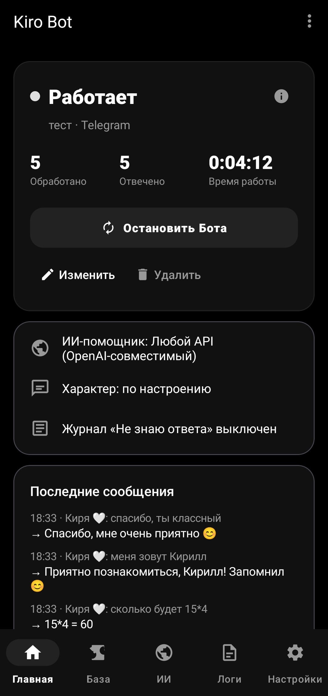

---

## 🆕 Что нового в 3.0

Полный список — в [CHANGELOG.md](CHANGELOG.md).

- **Только Telegram** — приложение целиком для Telegram, поддержка VK убрана.
- **Живой разговор** — бот помнит последние реплики, понимает «а ты?», «да», «почему?», реагирует на похвалу и ругань, запоминает имя («меня зовут…»), отвечает на несколько вопросов в одном сообщении и не повторяется.
- **Характер и настроение** — «Обычный», «Тёплый», «Дерзкий», «Вежливый» или «по настроению»: похвала делает бота теплее, грубость — сдержаннее.
- **Функции** — «чай или кофе?», «инфа что…», «когда я…», калькулятор, рандом, время и дата.
- **ИИ-помощник** — Claude, Gemini, YandexGPT или любой OpenAI-совместимый API (OpenAI, DeepSeek, Groq, Grok, OpenRouter, Ollama…). Отвечает, только когда в базе нет ответа.
- **Новый интерфейс** — главная-панель (статус, запуск одной кнопкой, счётчики, последние сообщения), нижняя панель разделов, настройки по разделам, жесты.
- **Журнал «Не знаю ответа»** и **обучение из чата** (`!запомни`, `!забудь`, `!незнаю`).
- **Картинки по ссылкам** (сайты, Pinterest, поиск картинок) приходят фото, видео — ссылкой.
- **Безопасность** — токен и ключи ИИ зашифрованы (Android Keystore), только HTTPS.

---

## ✨ Возможности

### 👥 Бот Telegram
Приложение управляет одним ботом: токен от [@BotFather](https://t.me/BotFather) (`/newbot`). Чтобы бот видел сообщения в группах: `/setprivacy` → Disable.

### 🧠 Поиск ответов
Приоритет: точная фраза → regex и маски `*` → совпадение по смыслу слов → частичное совпадение → запасной ответ.
- Редкие слова важнее частых («питон» важнее «как», «ты»); служебные слова не мешают.
- Длинное сообщение разбирается по фразам — приветствие не перебивает суть.
- Формы слов, опечатки, «ё» = «е», синонимы и сленг (`что = че, чо, шо`).
- Контекст диалога, лимит повторов, переменные `{name}`, `{time}`, `{date}`, `{random}`, `{1}` из regex.
- Несколько строк с одним вопросом — случайный ответ.

### 🎬 Команды с картинками и видео
В редакторе укажите вопрос (например, `аниме`) и в поле «Вложения» — ссылки, каждая с новой строки:
- **картинка или GIF из интернета** — в чате сразу видна как фото / анимация. Подходит прямая ссылка, **страница сайта** (берётся её картинка-превью), **пин Pinterest** (`pinterest.com/pin/…`, `pin.it/…`) и ссылка из **поиска картинок** Яндекса/Google/Bing. WebP, AVIF и HEIC перекодируются в JPEG;
- **видео** (YouTube, RuTube, TikTok и др.) и прочие ссылки — ссылкой с карточкой-превью.

Если картинку не удалось получить, бот отправит ссылку и напишет причину в «Логах».

Список команд — обычная строка: вопрос `команды`, ответ — список ваших команд.
В Telegram `/аниме`, `/как_дела`, `/anime@мой_бот` ищутся как «аниме», «как дела», «anime».

### 📚 Обучение
- **Журнал «Не знаю ответа»** — бот записывает вопросы, на которые не нашёл ответа, и считает, сколько раз их задавали. Кнопка-список в шапке редактора: нажали на вопрос → добавили ответ. Когда ответ появляется в базе, вопрос уходит из журнала сам.
- **Обучение из чата (только владелец)** — напишите боту `!id`, впишите свой ID в Настройки → «Управление из чата». Команды: `!запомни вопрос = ответ`, `!забудь вопрос`, `!незнаю` (топ вопросов без ответа), `!команды`. От остальных пользователей эти команды игнорируются — научить бота плохому посторонние не смогут.

### 🤖 ИИ-помощник
Когда в базе нет ответа, бот может спросить ИИ вместо запасной фразы (меню → «ИИ-помощник»):
- **Claude** (Anthropic, официальный SDK) — Opus 5, Sonnet 5, Haiku 4.5;
- **Gemini** (Google) — Gemini 3.8 Flash / Flash-Lite;
- **YandexGPT** — Lite и Pro (нужен идентификатор каталога);
- **Любой API** с OpenAI-совместимым форматом: OpenAI, OpenRouter, DeepSeek, Groq, Grok (xAI), Mistral, локальные Ollama / LM Studio — свой адрес и ключ, список моделей загружается сам по нажатию на поле «Модель».

Настройки: характер бота (инструкция для ИИ), максимум символов в ответе, дневной лимит запросов, ИИ в группах, кнопка «Проверить». ИИ помнит 3 последних обмена репликами с каждым собеседником. Ответы ИИ попадают в журнал «Не знаю ответа» как подсказки 🤖 — добавить их в базу можно одним нажатием. Запросы оплачиваются у выбранного сервиса по вашему ключу.

### 💬 Беседы и группы
Включаются в Настройках. Бот отвечает на префикс (по умолчанию «Бот,»); в Telegram — ещё на команды, упоминание `@бота` и ответы на свои сообщения. Другим ботам не отвечает.

### 📎 Реакция на вложения
Голосовые, фото, видео, стикеры, документы — шуточные ответы из файлов `media_*.txt`.

### 🛡️ Защита
Антиспам (обычный / строгий), автобан, чёрный список по числовому ID Telegram (смахните человека, чтобы убрать).

### 📱 Интерфейс
Главная — панель управления: статус, запуск одной кнопкой, счётчики за сеанс, ИИ, характер, журнал «Не знаю» и последние сообщения. Внизу — панель разделов: Главная, База, ИИ, Логи, Настройки. Живые логи с цветами, редактор с поиском, массовым удалением и резервной копией, тёмная тема Material 3.

  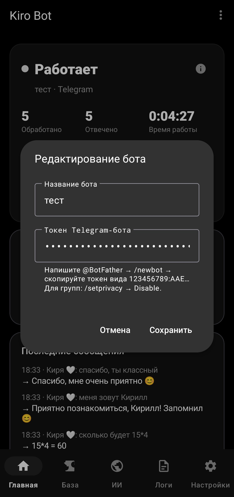
  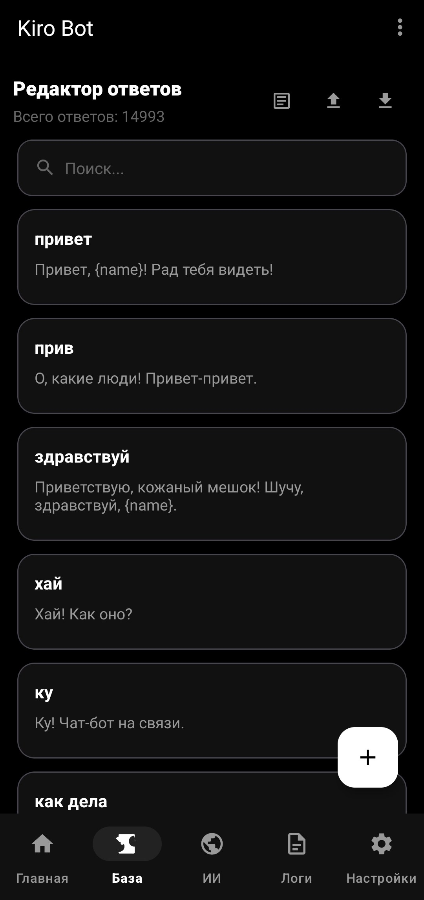
  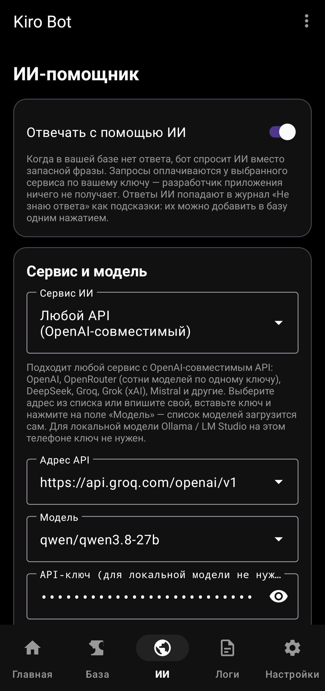

  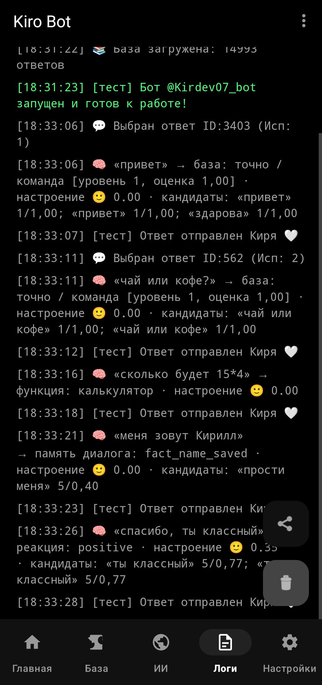
  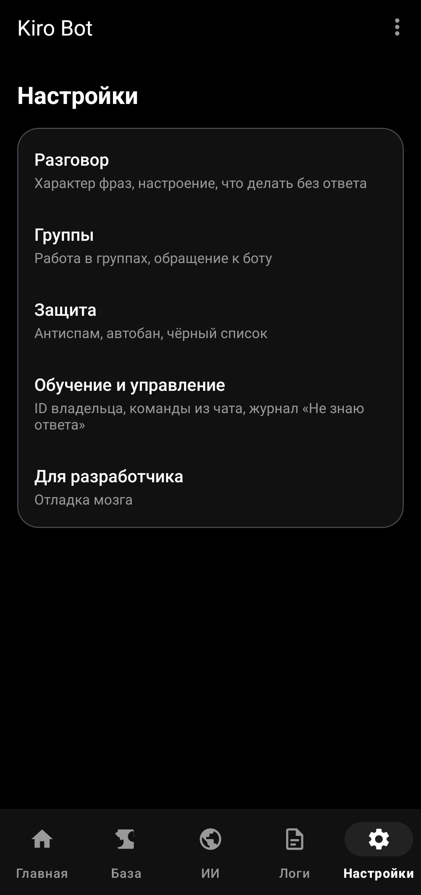
  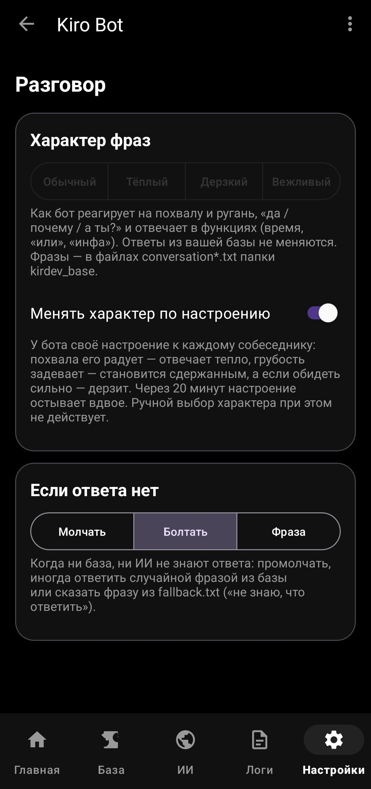

  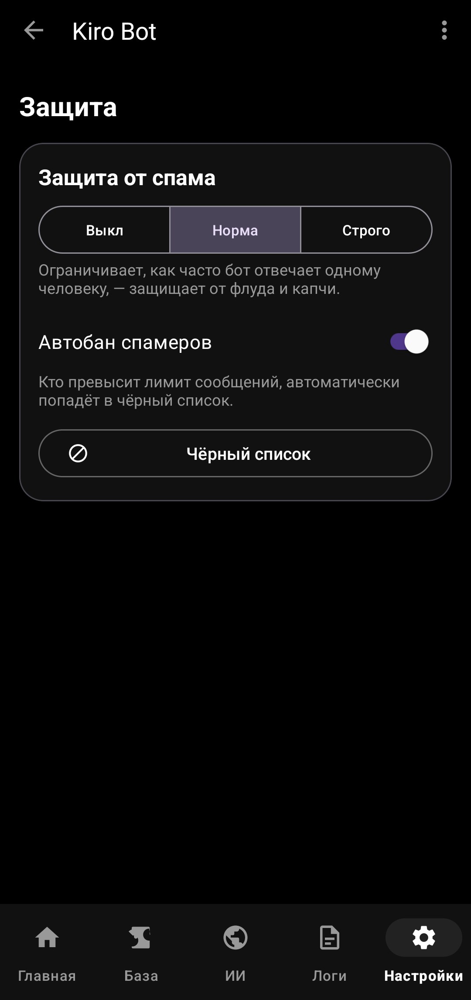
  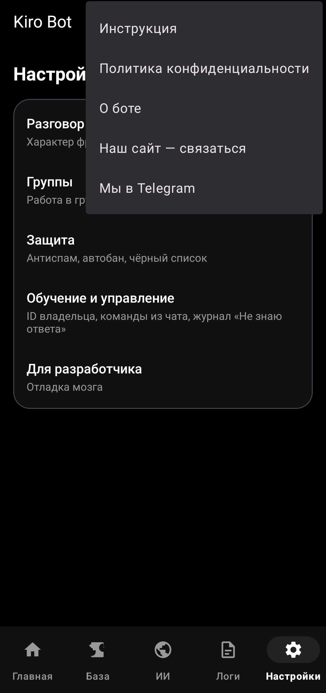
  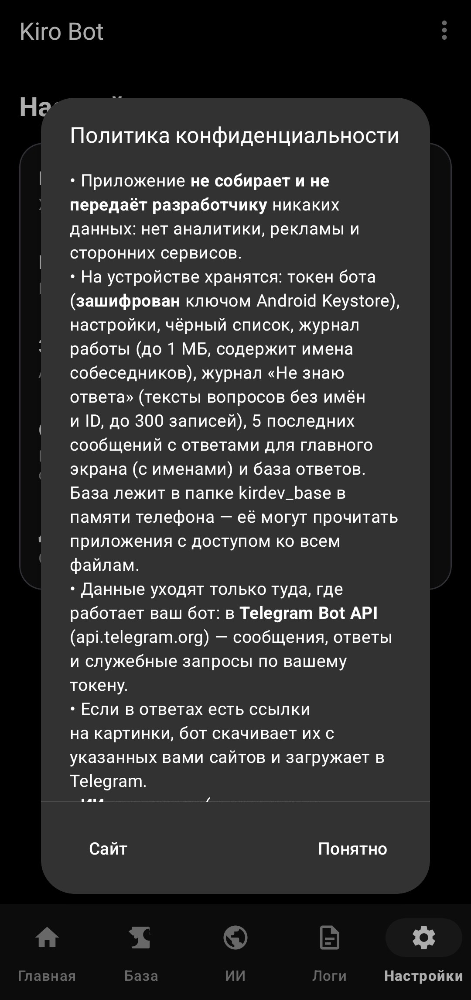

  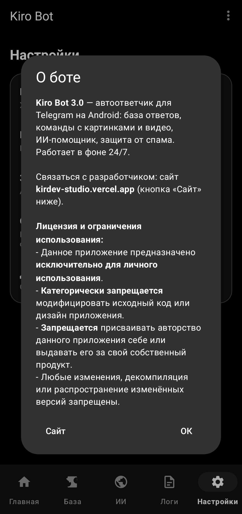

---

## 🚀 Быстрый старт

1. **Добавьте бота:** создайте бота у @BotFather, на главной «Добавить бота» → вставьте токен.
2. **Наполните базу:** раздел «База» внизу экрана — вопросы, ответы, вложения.
3. **Запустите:** нажмите «Запустить бота» на главном экране — отдельно включать бота не нужно.

> [!TIP]
> Для работы в фоне разрешите приложению «Автозапуск» и отключите ограничения экономии энергии.

---

## 🛠 Технический стек

- **Kotlin**, Coroutines, Material Design 3, View Binding.
- **Telegram:** Bot API (long polling).
- **База:** текстовые файлы в папке `kirdev_base` (`answer.txt`, `synonyms.txt`, `media_*.txt`).
- **Фон:** Foreground Service с автоперезапуском.
- **Безопасность:** токен шифруется ключом Android Keystore (AES-GCM).
- **Тесты:** 212 модульных тестов (поиск, разговор, Telegram, загрузка медиа, ИИ, команды) + инструментальные тесты шифрования.

---

## 🔒 Политика конфиденциальности

- Приложение **не собирает и не передаёт разработчику** никаких данных: нет аналитики, рекламы и сторонних сервисов.
- На устройстве хранятся: токен бота (**зашифрован**), настройки, чёрный список, журнал работы (до 1 МБ, содержит имена собеседников), журнал «Не знаю ответа» (тексты вопросов без имён и ID), 5 последних сообщений с ответами для главного экрана (с именами) и база ответов. База лежит в папке `kirdev_base` в памяти телефона — её могут прочитать приложения с доступом ко всем файлам.
- Данные уходят только туда, где работает ваш бот: в **Telegram Bot API** (`api.telegram.org`).
- Если в ответах есть ссылки на картинки, бот скачивает их с указанных вами сайтов и загружает в Telegram.
- **ИИ-помощник** (выключен по умолчанию): если его включить, сообщения без ответа в базе вместе с именем собеседника и последними репликами уходят выбранному сервису ИИ (Anthropic, Google, Яндекс или указанный вами адрес) по вашему ключу. Ключ хранится зашифрованным.
- Журналом можно поделиться только вручную.
- Чтобы удалить все данные: удалите приложение и папку `kirdev_base`. Вопросы о данных — через [сайт](https://kirdev-studio.vercel.app/).
- Вы отвечаете за соблюдение правил Telegram и за содержимое ответов бота.

## ✉️ Связь

Сайт разработчика: [kirdev-studio.vercel.app](https://kirdev-studio.vercel.app/) — вопросы, предложения, запросы по данным. В приложении: меню ⋮ → «Наш сайт — связаться».

## 📄 Лицензия

- Данное приложение предназначено **исключительно для личного использования**.
- **Категорически запрещается** модифицировать исходный код или дизайн приложения.
- **Запрещается** присваивать авторство данного приложения себе или выдавать его за свой собственный продукт.
- Любые изменения, декомпиляция или распространение изменённых версий запрещены.

Подробности в файле [LICENSE.md](LICENSE.md).

---

**Developed with ❤️ by KirDev**
